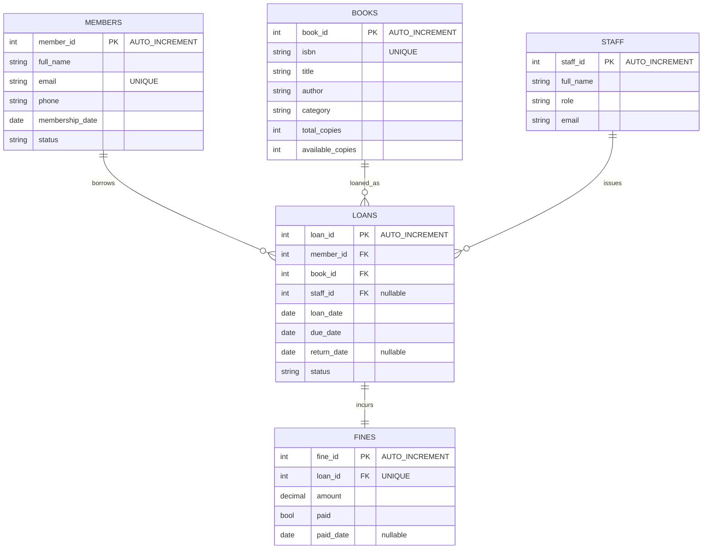

# Portfolio 1 — Database Design and Modelling (7 marks)

## Case study: CityLight Public Library
- **Organisation:** CityLight Public Library (simulated, Abuja) — lends books, manages members, tracks loans/returns/fines.
- **Users:** members/borrowers, librarians, assistants, admin.
- **Major data:** members, books (ISBN, title, author, category, copies), staff, loans (loan/due/return dates, status), fines.
- **Key operations:** register member, add book, borrow book, return book, calculate fine, search catalogue.

## ER design (implement exactly as in schema.sql)
- `members (1) — (M) loans (M) — (1) books`
- `staff (1) — (M) loans` (who issued the loan, nullable)
- `loans (1) — (1) fines` (one fine row per loan, UNIQUE on loan_id)
- Keys: PKs are AUTO_INCREMENT INTs; FKs: loans.member_id, loans.book_id, loans.staff_id, fines.loan_id.
- Constraints: UNIQUE(email), UNIQUE(isbn), UNIQUE(fines.loan_id), CHECK on copies/dates/email, ENUMs for status, ON DELETE CASCADE fines.

## ER diagram
Option A (fastest, 5 min): MySQL Workbench → Database → Reverse Engineer → select `citylight_library` → screenshot → save as `er-diagram.png` in this folder.
Option B (no screenshot needed): this Mermaid renders the same design — paste into README on GitHub or mermaid.live for a screenshot:

## Normalisation (write this in your own words on LMS)
- **1NF:** atomic columns, no repeating groups (one book per row, one loan per row; phone as single value).
- **2NF:** every non-key attribute fully depends on the whole PK (loan dates/status depend on loan_id, not on member_id+book_id).
- **3NF:** no transitive dependencies — member details live in `members`, book details in `books`, fine details in `fines`, not duplicated inside `loans`.
- Deliberate denormalisation: none (available_copies is a cached counter maintained by transactions in Portfolio 3 — state that).

## Evidence checklist (P1)
- [ ] `schema.sql` executed in Workbench (screenshot green ticks)
- [ ] `er-diagram.png` in this folder
- [ ] `SHOW TABLES;` + `DESCRIBE loans;` output screenshot
